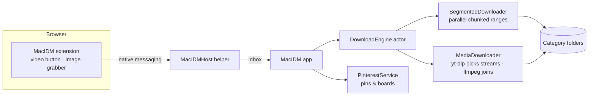

<div align="center">


# MacIDM

**A fast, native download manager for macOS.**
Parallel segmented downloads, reliable resume, browser integration and a one-click video grabber.

[](https://github.com/gmraselparvez/MacIDM/releases/latest)


### [⬇︎ Download the latest version](https://github.com/gmraselparvez/MacIDM/releases/latest)


</div>

---

## Highlights

| | |
|---|---|
| ⚡ **Up to 32 parallel connections** | Files are split into segments that download at the same time. When one finishes early, it takes over half of the largest remaining piece, so downloads stay fast to the end. |
| 🔁 **Resume that survives anything** | Pause, quit, restart your Mac or lose Wi-Fi: MacIDM picks up where it left off. If the file changed on the server, it starts over instead of saving a broken file. |
| 🎬 **Download this video** | A button appears on videos in Chrome. Pick a quality (4K, 1080p, 720p… or MP3/M4A) right on the page. |
| 🧩 **Browser integration** | Right-click → *Download with MacIDM*, optional automatic capture by file type, and downloads that need you to be signed in keep working. |
| 🖼 **Grab every image on a page** | One click on the MacIDM toolbar button (or ⌥⇧I) lists all the images on a page, full size, even on sites that block right-click. Pick and download. |
| 📌 **Pinterest boards** | Paste a pin, board or pin.it link and get every image at original resolution plus the videos, sorted into a folder per board. |
| 🗂 **Tidy by default** | Files land in `Video`, `Music`, `Images`, `Documents`, `Archives`, `Programs` or `Other`, with names from the server, and nothing gets overwritten. |
| 🕑 **Queue & scheduler** | Limit how many run at once, cap the speed (KB/s up to TB/s), start a queue at 2 AM, and optionally sleep the Mac when it's done. |

## Screenshots

<table>
  <tr>
    <td width="50%"><br><sub><b>Download window:</b> status, speed limiter, completion options and live per-connection progress.</sub></td>
    <td width="50%"><br><sub><b>Video downloads:</b> confirm the quality you picked on the page and choose where to save it.</sub><br><br><br><sub><b>One-click browser setup</b> with live status.</sub></td>
  </tr>
  <tr>
    <td colspan="2" align="center"><br><sub><b>Video site support</b> that updates itself.</sub></td>
  </tr>
</table>

## Install

1. Download **`MacIDM-<version>.dmg`** from the [latest release](https://github.com/gmraselparvez/MacIDM/releases/latest).
2. Open it and drag **MacIDM** into **Applications**.
3. The first time, **right-click MacIDM › Open**, then click **Open**. MacIDM isn't notarized by Apple yet, so macOS asks once. If macOS says it "can't be opened", go to **System Settings › Privacy & Security** and click **Open Anyway**.

Requires macOS 13 Ventura or later on an Apple silicon Mac.

**Check your download (optional):** each release lists the DMG's SHA-256. In Terminal, `shasum -a 256 ~/Downloads/MacIDM-*.dmg` should print the same value.

**Optional:** for HD video (which arrives as separate picture and sound) and MP3/M4A conversion, install ffmpeg with [Homebrew](https://brew.sh): `brew install ffmpeg`.

### Connect your browser (Chrome, Brave, Edge)

1. In MacIDM, open **Settings › Browser** and click **Set Up** next to your browser.
2. MacIDM opens the browser's Extensions page and copies the extension folder path. Turn on **Developer mode**, click **Load unpacked**, press **⇧⌘G**, paste, and choose **Select**.
3. The row turns **Ready**. Videos now show **Download this video**, and links get **Download with MacIDM** in the right-click menu.

## Features

- **Downloads:** up to 32 connections per file, smart re-splitting, retries, single-stream fallback, files over 4 GB, a clear message when the disk is full, and a fresh link can continue an expired download
- **Download window:** IDM-style status, per-download speed limiter, actions on completion, per-connection progress map
- **Images:** page image grabber with size filter (lazy-loaded, srcset, background and linked images), Pinterest pins and boards in original resolution
- **Video & audio:** best, 4K, 1440p, 1080p, 720p … or MP3 / M4A, saved as QuickTime-friendly MP4, with a quality menu right on the page
- **Productivity:** queue, scheduler, clipboard watcher, drag-and-drop, batch patterns like `photo[001-120].jpg`, import/export, menu bar, notifications, open at login, auto-resume after sleep or network loss

## Keyboard shortcuts

| Action | Shortcut | Action | Shortcut |
|---|---|---|---|
| Add URL | ⌘N | Resume | ⌘R |
| Grab Video | ⇧⌘N | Pause | ⌘. |
| Batch Download | ⌥⌘N | Stop | ⇧⌘. |
| Download from Pinterest | ⌥⌘B | Grab images (in the browser) | ⌥⇧I |
| Pinterest board (in the browser) | ⌥⇧P | | |
| Import list | ⌘O | Resume All | ⇧⌘R |
| Export list | ⇧⌘E | Pause All | ⇧⌘P |
| Show in Finder | ⌥⌘F | Open | ⌘↓ |

## Build from source

Requires macOS 13+ and the Xcode Command Line Tools (full Xcode is optional).

```bash
git clone https://github.com/gmraselparvez/MacIDM.git
cd MacIDM
swift test                   # 75 tests, including an in-process fake HTTP server
./scripts/fetch-tools.sh     # downloads yt-dlp (checksum-verified) for bundling
./scripts/make-app.sh        # builds and signs build/MacIDM.app
./scripts/make-dmg.sh        # packages build/MacIDM-<version>.dmg
```

Launch with `MACIDM_DEMO=1` to show sample downloads without saving or downloading anything. Signing, notarization and release steps are in [docs/RELEASING.md](docs/RELEASING.md).

### How it works



| Folder | What's inside |
|---|---|
| `Sources/MacIDMCore` | UI-independent engine: probing, segment planning, parallel chunked download, merge, resume, speed limiter, queue, scheduler, yt-dlp and Pinterest integration |
| `Sources/MacIDM` | SwiftUI app: main window, download windows, settings, menu bar |
| `Sources/MacIDMHost` | Native-messaging helper for the browser extension |
| `BrowserExtension/` | One MV3 extension for Chrome, Brave and Edge (`chrome/`) (video button, image grabber, Pinterest), plus a Safari handler (needs Xcode) |
| `Tests/MacIDMCoreTests` | swift-testing suites |

## Feedback & requests

Found a bug or want a feature? [Open an issue](https://github.com/gmraselparvez/MacIDM/issues/new/choose). Updates ship as new [releases](https://github.com/gmraselparvez/MacIDM/releases).

## Privacy & responsible use

- Everything runs on your Mac. MacIDM doesn't collect or send any data.
- Browser cookies are used only for the file you're downloading, are never exported, and are deleted when the download finishes. Nothing is sent from private windows.
- MacIDM does **not** bypass DRM, paywalls, captchas or logins. Only download content you have the right to download.

## License

MIT. See [LICENSE](LICENSE). yt-dlp is released under the Unlicense; FFmpeg isn't bundled (it uses LGPL/GPL licenses, so check them before bundling a build).

## Acknowledgments

- [yt-dlp](https://github.com/yt-dlp/yt-dlp) (Unlicense) for video site support, bundled with the app
- [FFmpeg](https://ffmpeg.org) for merging and conversion (not bundled)
- Inspired by Internet Download Manager. MacIDM is an independent project, not affiliated with or endorsed by Tonec Inc.
