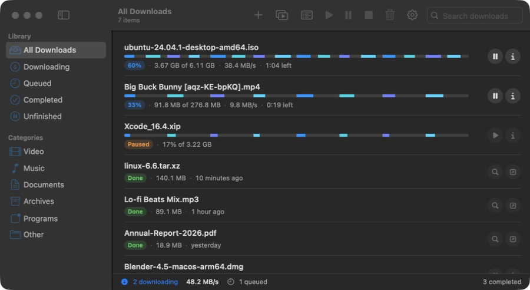
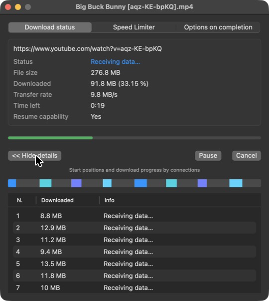
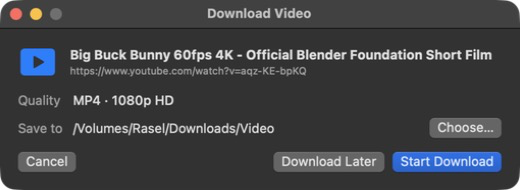
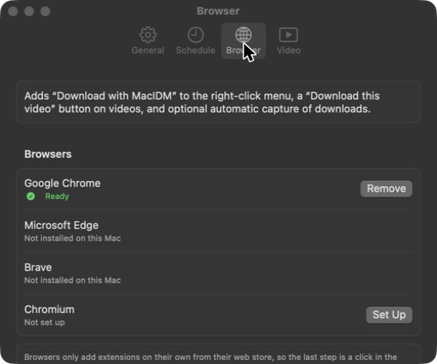
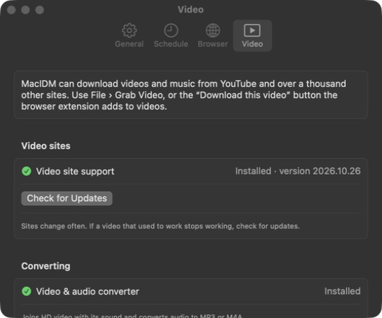
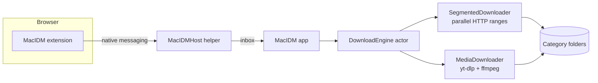

<div align="center">


# MacIDM

**A fast, native download manager for macOS.**
Parallel segmented downloads, reliable resume, browser integration and a one-click video grabber, built in Swift and SwiftUI.




</div>

---

## Highlights

| | |
|---|---|
| ⚡ **Up to 32 parallel connections** | Files are split into segments that download at the same time. When one finishes early, it takes over half of the largest remaining piece, the trick that makes IDM fast. |
| 🔁 **Resume that survives anything** | Pause, quit, restart your Mac or lose Wi-Fi: progress is saved per segment and checked against what's on disk. If the file changed on the server (ETag / Last-Modified), it starts over instead of corrupting it. |
| 🎬 **Download this video** | A button appears over videos in Chrome. Pick a quality (4K, 1080p, 720p… or MP3/M4A) right on the page. Powered by [yt-dlp](https://github.com/yt-dlp/yt-dlp). |
| 🧩 **Browser integration** | Right-click → *Download with MacIDM*, optional automatic capture by file type, and your logged-in downloads keep working. |
| 🗂 **Tidy by default** | Files land in `Video`, `Music`, `Documents`, `Archives`, `Programs` or `Other`. Names come from the server, and nothing gets overwritten. |
| 🕑 **Queue & scheduler** | Limit how many run at once, cap the speed (KB/s up to TB/s), start a queue at 2 AM, and optionally sleep the Mac when it's done. |

## Screenshots

<table>
  <tr>
    <td width="50%"><br><sub><b>Download window:</b> status, speed limiter, completion options and live per-connection progress.</sub></td>
    <td width="50%"><br><sub><b>Video downloads:</b> confirm the quality you picked on the page and choose where to save it.</sub><br><br><br><sub><b>One-click browser setup</b> with live status.</sub></td>
  </tr>
  <tr>
    <td colspan="2" align="center"><br><sub><b>Video site support</b> that updates itself, with checksum verification.</sub></td>
  </tr>
</table>

## Features

<details open>
<summary><b>Downloading</b></summary>

- Segmented parallel downloads (default 8, up to 32 connections) with dynamic re-splitting
- Probes with `HEAD`, falling back to `Range: bytes=0-0`; follows redirects
- Falls back to a single stream when a server ignores ranges, and handles unknown sizes
- Retries each connection with exponential backoff, and fails fast on expired links (403/410)
- Paste a refreshed URL to continue an expired download without losing progress
- Pauses with a clear message when the disk is full; 64-bit offsets everywhere (files over 4 GB)
- Per-download and global speed limits, KB/s to TB/s
</details>

<details>
<summary><b>Browser (Chrome, Edge, Brave)</b></summary>

- “Download this video” button with an on-page quality menu that starts looking up qualities while you hover
- Right-click menu for links, images, video and audio
- Optional auto-capture of browser downloads by file type and minimum size
- Sends the page address and **only the cookies for the file being downloaded**; nothing from private windows
- Native-messaging helper registered from Settings, with a pinned extension ID
</details>

<details>
<summary><b>Video & audio</b></summary>

- Best, 4K, 1440p, 1080p, 720p … or audio-only MP3 / M4A
- Saves H.264/AAC MP4 where available, so it plays in QuickTime
- Uses yt-dlp's unpacked macOS build (starts in ~0.2 s) and updates it in-app with SHA-256 verification
- Refuses known DRM services (Netflix, Disney+, Prime Video, Spotify…) with a clear message
</details>

<details>
<summary><b>Productivity</b></summary>

- Queue with max concurrent downloads, plus a daily scheduler with stop time and sleep-when-done
- Clipboard watcher (“Download this link?”), drag-and-drop, and batch patterns like `photo[001-120].jpg`
- Import/export the list as JSON or TXT (cookies never exported)
- Menu bar extra, notifications, open at login, and auto-resume after wake or network loss
</details>

## Getting started

Requires macOS 13 Ventura or later. Xcode is optional: the Command Line Tools are enough.

```bash
git clone https://github.com/gmraselparvez/MacIDM.git
cd MacIDM
./scripts/fetch-tools.sh     # downloads yt-dlp (checksum-verified) for bundling
./scripts/make-app.sh        # builds and signs build/MacIDM.app
open build/MacIDM.app
```

For HD video merging and MP3/M4A conversion, install ffmpeg: `brew install ffmpeg`.

### Connect your browser

1. In MacIDM, open **Settings › Browser** and click **Set Up** next to your browser.
2. MacIDM opens the browser's Extensions page and copies the extension folder path. Turn on **Developer mode**, click **Load unpacked**, press **⇧⌘G**, paste, and choose **Select**.
3. The row turns **Ready**. Hover any video and look for **Download this video**.

## Keyboard shortcuts

| Action | Shortcut | Action | Shortcut |
|---|---|---|---|
| Add URL | ⌘N | Resume | ⌘R |
| Grab Video | ⇧⌘N | Pause | ⌘. |
| Batch Download | ⌥⌘N | Stop | ⇧⌘. |
| Import list | ⌘O | Resume All | ⇧⌘R |
| Export list | ⇧⌘E | Pause All | ⇧⌘P |
| Show in Finder | ⌥⌘F | Open | ⌘↓ |

## How it works



| Folder | What's inside |
|---|---|
| `Sources/MacIDMCore` | UI-independent engine: probing, segment planning, parallel download, merge, resume, speed limiter, queue, scheduler, yt-dlp integration |
| `Sources/MacIDM` | SwiftUI app: main window, download windows, settings, menu bar |
| `Sources/MacIDMHost` | Native-messaging helper for the browser extension |
| `BrowserExtension/` | Chrome/Edge/Brave MV3 extension, plus the Safari handler (needs Xcode) |
| `Tests/MacIDMCoreTests` | 66 swift-testing tests, including an in-process fake HTTP server |

Run the tests with `swift test`. Launch with `MACIDM_DEMO=1` to show sample downloads without saving or downloading anything (handy for screenshots).

## Privacy & responsible use

- Everything runs locally. MacIDM doesn't collect or send any data.
- Browser cookies are used only for the exact file you download, are never exported, and are deleted when the download finishes.
- MacIDM does **not** bypass DRM, paywalls, captchas or logins. Only download content you have the right to download.

## Releasing

Developer ID signing, notarization and DMG packaging are covered in [docs/RELEASING.md](docs/RELEASING.md).

## Acknowledgments

- [yt-dlp](https://github.com/yt-dlp/yt-dlp) for video site support
- [FFmpeg](https://ffmpeg.org) for merging and conversion
- Inspired by Internet Download Manager. MacIDM is an independent project, not affiliated with or endorsed by Tonec Inc.
